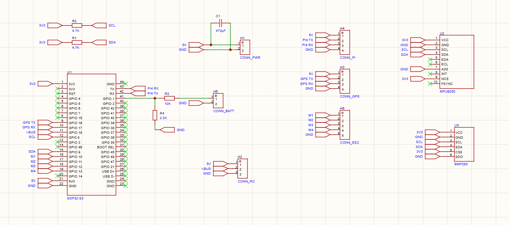
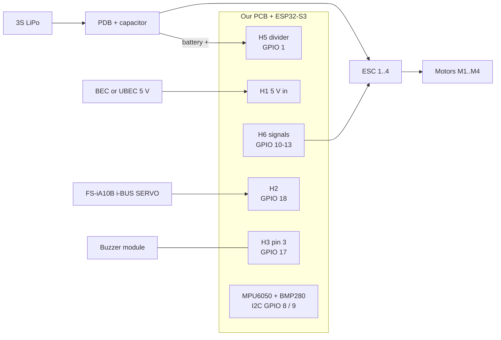

# 1. Hardware

## 1.1 Parts

| Part | What we use | Notes |
|------|-------------|-------|
| Frame | F330 with XT60 power distribution board (PDB) | low-ESR capacitor on the PDB battery pads (stripe = −) |
| Motors | 4 × A2212 2200KV | 6-inch props (6045), 2 CW + 2 CCW |
| ESCs | 4 × 20–30 A | calibrated to 1000–2000 µs (sketch 1) |
| Battery | 3S LiPo 3300 mAh, XT60 | 12.6 V full, 11.1 V nominal |
| Radio | FlySky FS-i6X + FS-iA10B | i-BUS on the "i-BUS SERVO" port |
| Flight controller | our PCB + ESP32-S3-DevKitC-1 **N16R8** | 16 MB flash, 8 MB octal PSRAM |
| IMU | GY-521 (MPU6050) in the U2 footprint | I²C address 0x68 |
| Barometer | GY-BMP280 in the U3 footprint | I²C address 0x76 or 0x77 (found automatically) |
| Buzzer (optional) | active buzzer **module, "high level trigger"** | on H3, see 1.5 |
| Power for the board | one ESC's BEC or a 5 V / 3 A UBEC | into H1 |

## 1.2 The PCB

| Connector | Pin | Signal | ESP32-S3 | Used by |
|-----------|-----|--------|----------|---------|
| **H1** CONN_PWR | 1 / 2 | 5 V / GND (470 µF C1 across) | 5V0 / GND | board power in flight |
| **H2** CONN_RC | 1 / 2 / 3 | 5 V / i-BUS / GND | – / **GPIO 18** / – | receiver |
| **H3** CONN_GPS | 1 / 2 / 3 / 4 | 5 V / GPS TX / GPS RX / GND | – / GPIO 16 / **GPIO 17** / – | **buzzer** on pin 3 (no GPS used) |
| **H4** CONN_PI | 1 / 2 / 3 / 4 | 5 V / PI4 TX / PI4 RX / GND | – / GPIO 44 / GPIO 43 / – | not used (see 1.6) |
| **H5** CONN_BATT | 1 / 2 | battery + through R3 10 k / GND | **GPIO 1** (R4 3.3 k to GND) | battery voltage |
| **H6** CONN_ESC | 1–4 / 5 | M1–M4 signal / GND | **GPIO 10, 11, 12, 13** / GND | ESCs |
| **U2** (MPU9250 footprint) | 1–4, 7 | VCC 3.3 V, GND, SCL, SDA, AD0 = GND | SCL **GPIO 8**, SDA **GPIO 9** | GY-521 (MPU6050), pins 9–10 empty |
| **U3** BMP280 | 1–6 | VCC, GND, SCL, SDA, CSB = 3.3 V, SDO = GND | same I²C bus | GY-BMP280 |
| R1 / R2 | – | 4.7 k pull-ups on SDA / SCL | – | I²C at 400 kHz |
| on the DevKit | – | RGB LED | **GPIO 48** (38 on some boards) | status LED |

All pin numbers live in `firmware/4_flight_controller/config.h` (section 3).

## 1.3 Power rules

- **Bench tests with the computer:** USB in, **H1 unplugged**. The LiPo may power the
  ESCs through the PDB, but the board runs from USB.
- **Flight:** USB **out**, H1 plugged (5 V from one BEC or a UBEC). Check the polarity of
  that 5 V with a multimeter before you plug it in.
- **Never USB and H1 at the same time.** Two 5 V sources fight each other.
- Only **one** BEC may feed the 5 V rail. Cut or tape the red wire of the other ESC leads.
- To **download a flight log**, unplug the LiPo after the long beep (log saved), then plug
  in USB. The log is in flash; it survives the power-off.

## 1.4 Voltage divider (H5)

The ESP32 can only measure 0–3.3 V, so the battery voltage goes through a divider:

$$V_{pin} = V_{bat}\,\frac{R_4}{R_3+R_4} = V_{bat}\,\frac{3.3}{13.3}
\qquad\Rightarrow\qquad V_{bat} = V_{pin}\cdot 4.03$$

A full 3S (12.6 V) gives 3.13 V on GPIO 1, just inside the ADC range. GPIO 1 is an ADC1
pin, so it keeps working while Wi-Fi is off or on. Resistors have a 1–5 % tolerance and
the ADC is not perfect: calibrate once with a multimeter (chapter 5).

## 1.5 Buzzer and LED

The board has no buzzer header, so the firmware uses the free **H3** (GPS) connector:

| Buzzer module | H3 pin |
|---------------|--------|
| VCC | 1 (5 V) |
| I/O (signal) | 3 (GPIO 17) |
| GND | 4 |

Use an **active** buzzer module marked **"high level trigger"** (it has an NPN transistor,
e.g. S8050). The 3.3 V from the ESP32 switches it on cleanly. A "low level trigger" module
powered from 5 V will **not** switch off with 3.3 V logic (it would beep all the time); if
that is all you have, set `BUZZER_ACTIVE_HIGH false` and power its VCC from 3.3 V instead.
A bare passive piezo also works with `BUZZER_PASSIVE true` (the code then makes a 2.7 kHz
tone with the LEDC peripheral).

No buzzer? Set `BUZZER_PIN -1`. Everything else still works; the LED and the Serial
Monitor show the same information.

The **RGB LED** is the small WS2812 on the DevKit. Most N16R8 boards use GPIO 48; some
DevKitC-1 v1.1 boards use GPIO 38. If the LED stays dark, try 38 in `RGB_LED_PIN`.

## 1.6 Known PCB issues and notes

| # | Observation | Effect | What we do |
|---|-------------|--------|-----------|
| 1 | H4 (Raspberry Pi) uses GPIO 43/44 = UART0, the same lines as the USB "COM" port | a device on H4 disturbs uploads and the Serial Monitor | keep H4 empty; on a next PCB move it to free pins (e.g. GPIO 4/5) |
| 2 | U2 is an MPU9250 footprint | the GY-521 fits pins 1–8; there is no magnetometer | fine for angle mode and altitude hold |
| 3 | U3 ties SDO to GND (address 0x76), but our BMP280 answers at **0x77** | depends on the module's own pull-up / solder joint | the code tries 0x76 then 0x77 |
| 4 | No buzzer or LED connector | – | buzzer on H3 pin 3 (GPIO 17) |
| 5 | Board power from USB and H1 are not isolated | back-feeding risk | never both at once (1.3) |
| 6 | Long I²C wires, motor noise | NACK errors, frozen sensor | short wires, sensors flat and firm; the driver's error messages are muted, `i2cDoctor` in sketch 3 finds wiring faults |

Ideas for a version 2 of the PCB: a buzzer transistor + header, a 5 V / 3.3 V
separation diode for USB, a current sensor input on an ADC1 pin (`CURRENT_PIN`),
a JST-GH connector for a GPS + compass, and moving the Pi UART off GPIO 43/44.
