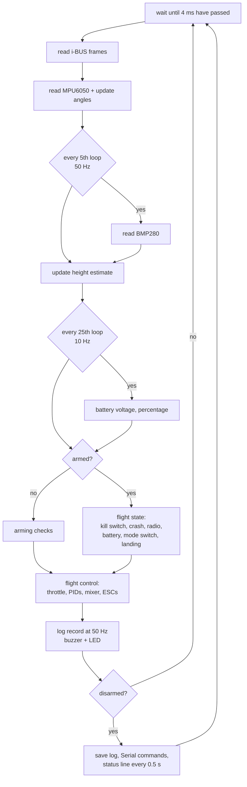
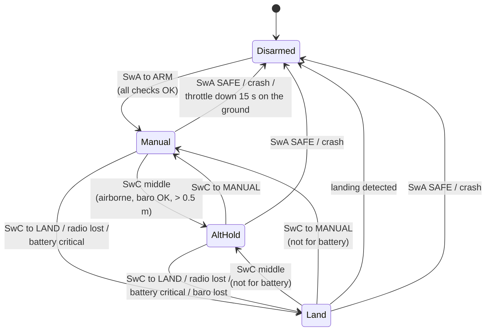

# 2. Firmware overview

## 2.1 The sketches

| Folder | When | What it does |
|--------|------|--------------|
| `firmware/1_motor_test` | guide steps 2–6 | ESC arming and calibration, motor order and direction, emergency stop, beep decoder |
| `firmware/2_receiver_test` | guide step 7 | live radio channels, shows ARM/SAFE and MANUAL/ALT HOLD/LAND, failsafe check |
| `firmware/3_imu_test` | guide step 8 | MPU6050 orientation + level calibration, I²C doctor |
| `firmware/4_flight_controller` | guide steps 10–12 and this documentation | **the flight code** |
| `firmware/extras/bench_test` | any time | all-in-one bench check (props off!) |

Arduino IDE, **Tools** menu (the same for every sketch):

| Setting | Value |
|---------|-------|
| Board | ESP32S3 Dev Module |
| USB CDC On Boot | Disabled (use the USB-C port marked COM / UART) |
| Flash Size | 16MB (128Mb) |
| PSRAM | **OPI PSRAM** (needed for the 16-minute flight log) |
| Partition Scheme | **16M Flash (3MB APP/9.9MB FATFS)** (needed to save logs) |
| Upload Speed | 115200 |

Arduino-ESP32 core 2.x and 3.x both work (`#if ESP_ARDUINO_VERSION_MAJOR >= 3` picks
the right LEDC / LED functions).

## 2.2 Files of the flight controller

The `.ino` file holds the decisions (arming, modes, failsafes, landing detector, logging,
Serial Monitor). Each `.h` file is one module.

| File | Job |
|------|-----|
| `config.h` | **all user settings** – normally the only file you edit |
| `util.h` | constants, `clampf`, I²C read/write helpers |
| `rc_ibus.h` | FlySky i-BUS decoder, radio-lost timer, stick scaling, mode switch decoding |
| `motors.h` | ESC signal (LEDC hardware PWM, 14-bit) and the Quad-X mixer |
| `pid.h` | the rate PID used for roll, pitch and yaw |
| `imu_mpu6050.h` | MPU6050 driver, axis mapping, complementary filter, vertical acceleration |
| `baro_bmp280.h` | BMP280 driver with Bosch's integer compensation formulas |
| `altitude.h` | height estimator (3rd-order complementary filter) and height controller |
| `battery.h` | voltage, sag compensation, percentage, LOW / CRITICAL states |
| `status_beeper.h` | non-blocking buzzer patterns and RGB LED |
| `flight_log.h` | flight recorder: PSRAM during flight, FAT file in flash after landing, CSV dump |

## 2.3 The main loop

The loop runs at a fixed **250 Hz** (every 4 ms). A busy-wait at the start keeps the
period exact, because the PID gains are tuned "per loop".



Typical time used per loop on the ESP32-S3: about 0.6 ms for the MPU6050 read (I²C at
400 kHz), 0.3 ms extra when the BMP280 is read, well under 0.1 ms for all the maths.
Nothing blocks while armed: no printing (a USB serial port that is not connected can
stall), no flash writes (they pause the CPU). Events during the flight are kept in RAM
and printed after landing as a **flight summary**.

## 2.4 Flight modes and switches

| Switch | Position (value) | Meaning |
|--------|------------------|---------|
| **SwA → CH5** | ~2000 = **ARM** | motors may run |
|  | ~1000 = **SAFE** | motors stop at once, in every mode (**kill switch**) |
| **SwC → CH6** | ~1000 = **MANUAL** | self-levelling, you control the throttle |
|  | ~1500 = **ALT HOLD** | the drone holds its height (barometer) |
|  | ~2000 = **LAND** | lands slowly and stops the motors |

Which physical position gives 1000 or 2000 depends on the transmitter: check with
sketch 2, which prints `ARM/SAFE` and `MANUAL/ALT HOLD/LAND` live. Use the transmitter's
*Reverse* menu if you prefer the other direction.



**Mode switch details.** The firmware reacts to a *change* of the switch, not to its
position. MANUAL and LAND act at once; the middle (ALT HOLD) must be stable for 0.15 s,
because a quick flip from one end to the other passes through the middle. A mode that is
refused (for example ALT HOLD on the ground) gives 3 fast beeps; flip the switch again
when the reason is gone.

## 2.5 Arming

Arming happens when SwA moves from SAFE to ARM and **all** of these are true. Otherwise
you hear 3 fast beeps and the Serial Monitor says why (`NO ARM: ...`).

| Check | Why |
|-------|-----|
| radio frames arrive | no arming without control |
| MPU6050 found | no stabilisation without it |
| throttle stick fully down (< 1050 µs) | motors start at idle, not at your stick position |
| SwC on MANUAL | the drone never takes off in an automatic mode by surprise |
| drone level (within 25°) | the angle estimate starts correct |
| battery ≥ `CELL_MIN_ARM_V` (3.75 V/cell at rest) | do not take off with an empty pack (skipped when only USB powers the board) |
| SwA was seen on SAFE before | a switch left on ARM at power-on never arms the motors |

## 2.6 What stops the motors or lands the drone

| Situation | In the air | On the ground |
|-----------|------------|---------------|
| SwA to SAFE | motors stop at once | motors stop |
| radio frames lost for 0.25 s | **LAND** (sticks centred); radio back: move SwC to take over | motors stop |
| receiver failsafe values (CH6 = LAND, CH3 low) | **LAND** (because SwC reads LAND) | motors stop |
| battery CRITICAL for 5 s | **LAND**, SwC is locked, you can still steer | warning only |
| barometer lost in ALT HOLD | **LAND without barometer** (fixed throttle 40 µs under hover, motors stop after 20 s) | – |
| tilt over 70° (crash, motor failure) | motors stop + lost-drone beeper | motors stop |
| MPU6050 not answering for 80 ms | motors stop | motors stop |
| landing detected in LAND (or ALT HOLD with throttle fully down) | – | motors stop |
| throttle down for 15 s in MANUAL | – | motors stop |

## 2.7 Settings in `config.h`

| Section | Setting | Default | Meaning |
|---------|---------|---------|---------|
| 1 IMU | `IMU_ROTATION`, `IMU_UPSIDE_DOWN` | 0, false | how the GY-521 sits (from sketch 3) |
|  | `ACC_ROLL_TRIM`, `ACC_PITCH_TRIM` | 0.00 | level calibration (from sketch 3) |
| 2 ESC | `ESC_FREQ_HZ` | 250 | fastest signal speed that worked in sketch 1 |
|  | `MOTOR_OFF`, `MOTOR_IDLE`, `MOTOR_MAX` | 1000, 1100, 2000 | µs |
|  | `THROTTLE_MAX` | 1800 | leaves room for the stabiliser at full throttle |
| 3 Pins | `MOTOR_PINS`, `IBUS_RX_PIN`, `I2C_*`, `VBAT_PIN`, `BUZZER_*`, `RGB_LED_PIN`, `CURRENT_PIN` | see chapter 1 | |
| 4 Channels | `CH_ROLL` … `CH_MODE` | CH1–CH6 | counted from 0 in the code |
| 5 Sticks | `MAX_ANGLE_DEG`, `LEVEL_GAIN`, `MAX_YAW_RATE` | 30°, 5, 150°/s | how the drone answers the sticks |
| 6 PID | `P_ROLL`, `I_ROLL`, `D_ROLL`, `P_YAW`, `I_YAW`, `D_YAW`, `PID_MAX` | 1.3 / 0.04 / 18, 4 / 0.02 / 0, 400 | pitch uses the roll values |
| 7 Battery | `BATTERY_CELLS`, `VBAT_DIVIDER`, `VBAT_CAL` | 3, 4.03, 1.00 | chapter 5 |
|  | `CELL_WARN_V`, `CELL_CRITICAL_V`, `CELL_ABS_MIN_V`, `CELL_MIN_ARM_V` | 3.75, 3.65, 3.30, 3.75 | V per cell |
|  | `CURRENT_A_PER_V`, `CURRENT_OFFSET_V` | 0, 0 | optional current sensor |
| 8 Altitude | `ALT_HOLD_ENABLED` | true | false = barometer not used at all |
|  | `ALT_P`, `VEL_P`, `VEL_I`, `VEL_I_MAX` | 0.8, 80, 40, 150 | height controller gains (chapter 4) |
|  | `ALT_MAX_CLIMB`, `ALT_MAX_DESCENT`, `ALT_STICK_DEADBAND` | 0.8 m/s, 0.6 m/s, 100 µs | stick feel in ALT HOLD |
|  | `HOVER_THROTTLE_GUESS` | 1500 | replaced by the learned value after 2 s of steady flight |
| 9 Landing | `LAND_SPEED_FAST`, `LAND_SPEED_SLOW`, `LAND_SLOW_ALT` | 0.6, 0.3 m/s, 1.5 m | descent profile |
|  | `LAND_TIMEOUT_S` | 30 s | safety net: time below 1.5 m before the motors stop anyway |
|  | `LAND_NOBARO_DROP`, `LAND_NOBARO_TIME_S` | 40 µs, 20 s | landing without barometer |
| 10 Log | `LOG_ENABLED`, `LOG_HZ`, `LOG_MAX_FILES` | true, 50, 20 | chapter 7 |
|  | `DEBUG` | true | status lines and messages on the Serial Monitor |

## 2.8 Serial Monitor (115200 baud, only while disarmed)

Every 0.5 s a status line shows whether the drone is ready and, if not, why:

```
READY | roll  +0.3 pitch  -0.2 | THR 1000 SwA SAFE SwC MANUAL | h +0.04 m | 12.53 V 98%
WAIT  | roll  +0.4 pitch  -0.1 | THR 1312 SwA SAFE SwC MANUAL | h +0.03 m | 12.53 V 98%  <- throttle not fully down
```

| Type | Does |
|------|------|
| `h` | help |
| `i` | info: sensors, battery and sag factor, learned hover throttle, log memory, last flight summary |
| `s` | status lines on / off |
| `l` | list saved logs |
| `d` / `d3` | print the newest log / log 3 as CSV |
| `X` | erase all logs |
| `z` | set height 0 here |

After each flight the summary is printed, for example:

```
---- Last flight: 53.1 s, highest 4.0 m, lowest 3.92 V/cell under load, now 91% ----
      0.9 s  airborne
      6.7 s  ALT HOLD at 2.1 m
     43.9 s  LAND (switch)
     53.1 s  DISARMED: landed
```

## 2.9 Beeps and LED

| Beep | Meaning |
|------|---------|
| 1 long (0.5 s) | ready to arm (after power-on, and after the log is saved) |
| 1 short | armed, or mode accepted |
| 2 short | disarmed |
| 3 fast | refused (arming or mode): read the reason on the Serial Monitor |
| short beep every second | battery LOW |
| fast chirps | battery CRITICAL |
| beep-beep (0.25 s) | landing |
| short chirp every 2 s | "find me": after a crash or a radio-loss landing, until the next arm |

| LED | Meaning |
|-----|---------|
| yellow | starting (gyro calibration: keep the drone still) |
| green / green blinking | ready to arm / not ready (status line says why) |
| blue | armed, MANUAL |
| purple | armed, ALT HOLD |
| orange blinking | LAND |
| yellow flashes | battery LOW |
| red blinking | battery CRITICAL, or MPU6050 missing |
| white | saving the flight log: **do not unplug** |
