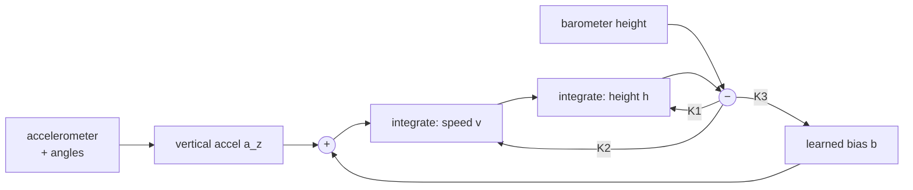

# 3. Sensor fusion: angles and height

The controller can only be as good as its idea of where the drone is. Two estimates are
needed: the **tilt angles** (roll, pitch) and the **height** with its vertical speed.
Each comes from two sensors that are bad in opposite ways, combined with a
*complementary filter*.

## 3.1 Conventions

| Quantity | Positive when |
|----------|---------------|
| roll | right side goes down |
| pitch | nose goes up |
| yaw rate | nose turns right |
| height, vertical speed | up |

The firmware first rotates the raw MPU6050 axes into the drone's axes (forward, left,
up) using `IMU_ROTATION` and `IMU_UPSIDE_DOWN` from sketch 3 (`mapAxes()` in
`imu_mpu6050.h`). Everything after that is independent of how the chip is mounted.

MPU6050 settings: digital low-pass filter ≈ 44 Hz (cuts motor vibration), gyro ±500 °/s
(65.5 counts per °/s), accelerometer ±8 g (4096 counts per g). At power-on the gyro is
averaged over 2000 samples (8 s) to find its offset: **keep the drone still** while the
LED is yellow.

## 3.2 Tilt angles: complementary filter

- The **gyroscope** measures rotation speed. Integrating it gives the angle: smooth and
  fast, but every small offset adds up, so the angle *drifts* slowly.
- The **accelerometer** measures the direction of gravity. It gives the angle directly and
  never drifts, but it is noisy (vibration) and is fooled by acceleration.

From the accelerometer (in g, drone axes $a_f, a_l, a_u$):

$$\phi_{acc} = \operatorname{atan2}(a_l,\ a_u) \qquad
\theta_{acc} = \operatorname{atan2}\!\left(a_f,\ \sqrt{a_l^2 + a_u^2}\right)$$

Every loop ($\Delta t$ = 4 ms) the filter does:

$$\phi \leftarrow \phi + \omega_{roll}\,\Delta t, \qquad
\phi \leftarrow \phi + k\,(\phi_{acc} - \phi)$$

(the same for pitch). With $k = 0.002$ the angle follows the gyro and is pulled towards
the accelerometer with a time constant

$$\tau = \frac{\Delta t}{k} = \frac{0.004}{0.002} = 2\ \text{s}.$$

Fast motions come from the gyro, the long-term level from the accelerometer. While
**disarmed** the firmware uses $k = 0.02$ ($\tau$ = 0.2 s): the motors are off, there is no
vibration, so the angle settles quickly (useful after you pick the drone up).

**Yaw coupling.** When the drone turns while tilted, roll becomes pitch and the other way
round. The code rotates the two angles by the yaw step $\sin(\omega_{yaw}\Delta t)$ each loop
(the same trick as YMFC-AL).

The rates sent to the PID are smoothed once more (`0.7·old + 0.3·new`) against vibration.
This is the classic filter described by Colton ("The Balance Filter") and used by most
hobby flight controllers; Mahony and Madgwick filters (see [resources](resources.md)) are
the next step up.

## 3.3 Height from the barometer

The BMP280 measures air pressure. Air pressure falls by about **12 Pa per metre** near
sea level, so 1 Pa ≈ 8 cm. Settings (`baro_bmp280.h`): pressure oversampling ×8,
temperature ×1, internal IIR filter ×4, normal mode with 0.5 ms standby: a new value about
every 23 ms with roughly 5–10 cm of noise. The raw values are converted with Bosch's
64-bit integer formulas from the datasheet (the simulator checks them against the
datasheet's floating-point version).

Height above the take-off point, with $p_0$ the pressure measured when arming:

$$h = 44330\left(1 - \left(\frac{p}{p_0}\right)^{0.190295}\right)\ \text{m}$$

Problems of the barometer alone: noise, a lag of ~0.1 s, **prop wash** (the air pushed by the
props changes the pressure around the sensor, often 10–30 cm), light and wind, and slow
drift with temperature. Cover the sensor with a small piece of **open-cell foam** (like the
foam in headphone pads) and keep it out of direct sunlight.

## 3.4 Vertical acceleration

The accelerometer measures *specific force* in the drone's axes. Using the estimated
angles, the code projects it on the vertical (`verticalAccel()`):

$$f_{up} = a_f \sin\theta + a_l \sin\phi\cos\theta + a_u \cos\phi\cos\theta \quad [g]$$

$$a_z = (f_{up} - 1)\cdot 9.81\ \text{m/s}^2$$

At rest $f_{up}$ is exactly 1 g, so $a_z$ = 0. It is then low-pass filtered at about 5 Hz.

## 3.5 Height: third-order complementary filter

The barometer is slow but never drifts; the accelerometer is fast but double-integrating it
drifts in seconds. The filter in `altitude.h` (the structure used by ArduPilot's original
`AP_InertialNav`) estimates height $\hat h$, vertical speed $\hat v$ **and** the accelerometer
error $\hat b$:

$$e = h_{baro} - \hat h$$

$$\hat b \leftarrow \hat b + K_3\, e\,\Delta t$$

$$\hat v \leftarrow \hat v + (a_z + \hat b + K_2\, e)\,\Delta t$$

$$\hat h \leftarrow \hat h + (\hat v + K_1\, e)\,\Delta t$$

with $K_1 = 3/\tau,\ K_2 = 3/\tau^2,\ K_3 = 1/\tau^3$. These gains put all three poles of the
error dynamics at $-1/\tau$:

$$s^3 + K_1 s^2 + K_2 s + K_3 = \left(s + \tfrac{1}{\tau}\right)^3$$

so the filter settles smoothly, without overshoot. We use $\tau$ = 1.5 s: for changes
faster than ~1.5 s the accelerometer is trusted, for slower ones the barometer. The
learned bias $\hat b$ removes the accelerometer's offset (and part of the vibration error)
while flying.

Result in the simulator (grey = barometer only, blue = fused height):

Without a working barometer (`baroOk` false) the height is marked invalid: ALT HOLD is
refused and LAND uses a fixed throttle (chapter 6).

## 3.6 What to check on your drone

- Sketch 3 / `bench_test` `i`: angles follow the tilt, return to ~0 when level.
- Flight controller `i` command: BMP280 found, pressure plausible (~1000 hPa near sea
  level, less in the mountains), temperature plausible.
- Lift the drone 1 m by hand (props off, disarmed): the status line height `h` must follow
  within about 0.2 m. Type `z` to set zero.
- After a flight, compare `alt` and `baro_alt` in the log plot: the fused line must be
  smooth and follow the barometer without lag.
