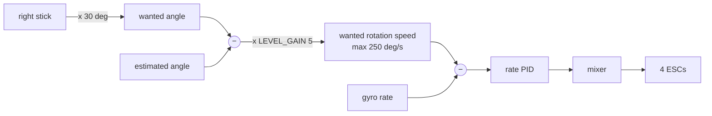
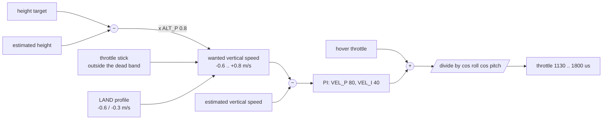

# 4. Control

Two controllers run every 4 ms: the **attitude** controller (keeps the drone level or at
the wanted tilt) and, in ALT HOLD and LAND, the **height** controller (decides the
throttle). Both are *cascades*: an outer loop decides what the inner loop should aim for.

## 4.1 Attitude: angle mode (self-levelling)



1. **Stick → wanted angle.** Full right stick = 30° (`MAX_ANGLE_DEG`). Centred = level.
2. **Angle error → wanted rotation speed:** $\omega_{set} = 5\,(\phi_{want} - \phi)$. 10° away from
   the target → turn at 50 °/s towards it.
3. **Rate PID** makes the real rotation speed follow $\omega_{set}$. Yaw has no angle loop: the
   yaw stick directly sets a turn rate (max 150 °/s).

The PID runs at a fixed 250 Hz, so its gains are "per loop" (like YMFC-AL):

$$u = K_P\,e + \sum K_I\,e + K_D\,(e - e_{prev}), \qquad |u| \le 400\ \mu s$$

Per second this means $K_I$ × 250 and $K_D$ × 250 (or ÷ 0.004 s). Start values for our
F330 / A2212 / 6-inch setup: $K_P$ = 1.3, $K_I$ = 0.04, $K_D$ = 18 (pitch = roll),
yaw $K_P$ = 4, $K_I$ = 0.02.

**I-term rules** (they prevent the classic "flips at take-off / touchdown"):

- MANUAL with the throttle stick down: motors at idle and the PIDs are reset.
- Until the drone is **airborne** the I-terms are held at zero. On a slope, the I-term would
  otherwise grow while the drone cannot move and then tip it over.
- When the landing detector thinks the drone touches the ground, the I-terms decay quickly.

## 4.2 The Quad-X mixer

```
        M4 (CW)    M2 (CCW)          front
             \  /
             /  \
        M3 (CCW)   M1 (CW)
```

$$\begin{aligned}
M_1 &= T - R - P - Y \quad &\text{rear right, CW}\\
M_2 &= T - R + P + Y &\text{front right, CCW}\\
M_3 &= T + R - P + Y &\text{rear left, CCW}\\
M_4 &= T + R + P - Y &\text{front left, CW}
\end{aligned}$$

$T$ = collective throttle, $R, P, Y$ = PID outputs. +R lifts the left side (right side goes
down), +P lifts the front (nose up), +Y speeds up the CCW props whose reaction torque turns
the nose right. Each output is limited to `MOTOR_IDLE`…`MOTOR_MAX` (1100–2000 µs), so the
motors never stop in flight.

## 4.3 Height controller (ALT HOLD and LAND)



$$v_{set} = \operatorname{clamp}\big(0.8\,(h_{target} - \hat h),\ -0.6,\ +0.8\big)\ \text{m/s}$$

$$T = T_{hover} + 80\,(v_{set} - \hat v) + I, \qquad \dot I = 40\,(v_{set} - \hat v),\ |I| \le 150$$

$$T_{out} = 1000 + \frac{T - 1000}{\max(\cos\phi\cos\theta,\ 0.7)}$$

- **Hover throttle.** The throttle that holds the drone in the air is *learned*: while flying
  level and steady for more than 2 s, the firmware averages the throttle (over ~3 s). When
  ALT HOLD or LAND starts, it is the starting point, so the drone does not jump or sink.
  The I-term then corrects what is left (battery voltage dropping, payload…).
- **Tilt compensation.** A tilted drone has less vertical lift; dividing by
  $\cos\phi\cos\theta$ keeps the height when you fly forward.
- **Anti-windup.** When the output is at a limit, the I-term is not allowed to grow further
  in that direction.
- **Stick in ALT HOLD.** Within ±100 µs of the middle: hold the current height. Above:
  climb, up to 0.8 m/s at full stick. Below: descend, up to 0.6 m/s. While you move, the
  target follows the drone; when you let the stick back to the middle, the drone stops and
  holds the new height.

What it looks like (simulated flight: take-off in MANUAL, ALT HOLD at 2 m, 3 s of climb,
ALT HOLD at 3.8 m, LAND):


## 4.4 Tuning

### Attitude (guide step 12, short version)

| Symptom | Change |
|---------|--------|
| slow, "lazy" return to level, drifts | raise `P_ROLL` by 0.1 steps |
| fast shaking (buzz) in hover | lower `D_ROLL`; balance the props; soft-mount the board |
| slow wobble after a stick move | raise `D_ROLL` a bit, or lower `P_ROLL` |
| slowly leans one way in hover | `ACC_*_TRIM` (sketch 3), then a little more `I_ROLL` |
| yaw drifts or turns after a stop | raise `P_YAW`, then `I_YAW` |

Change one value at a time, write it down, fly, compare the logs (chapter 7).

### Height (only after the attitude is good)

| Symptom in ALT HOLD | Cause | Change |
|---------------------|-------|--------|
| slow up-down "breathing" (several seconds) | I too high or barometer noise | lower `VEL_I` (40 → 25); foam on the BMP280 |
| fast bouncing (about 1 s) | speed loop too strong | lower `VEL_P` (80 → 60) |
| sinks or climbs for seconds after switching to ALT HOLD | hover throttle not learned yet / wrong | hover steady 3 s in MANUAL first; check `i` after landing |
| lazy, drifts 0.5 m before correcting | `ALT_P` too low | raise `ALT_P` (0.8 → 1.0) |
| overshoots after climbing | `ALT_P` too high | lower `ALT_P` |
| jumps when the motors spin up / near the ground | prop wash on the barometer | foam, move the sensor away from the airflow |

Good targets: in calm air the drone holds ±0.3 m. The simulator holds ±0.3 m with
realistic noise and drift (scenario 8: 3 minutes, worst error 0.31 m).
