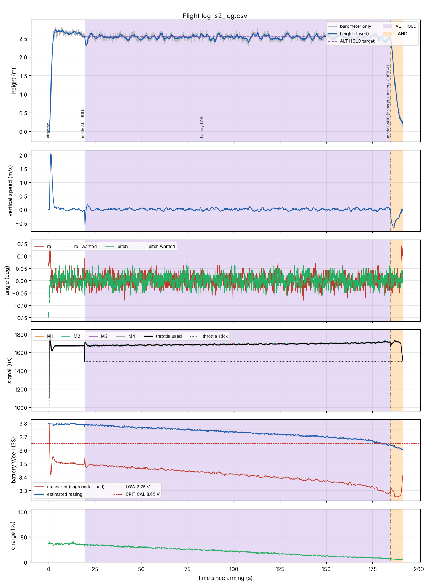

# 5. Battery management

## 5.1 Measuring the voltage

GPIO 1 measures the battery through the H5 divider (chapter 1.4). The firmware uses
`analogReadMilliVolts()`, which applies the chip's factory ADC calibration, then:

$$V_{bat} = V_{pin}\cdot\frac{R_3+R_4}{R_4}\cdot \texttt{VBAT\_CAL}$$

**Calibrate once:**

1. Plug in the LiPo (props off), open the Serial Monitor, type `i`.
2. Measure the battery at the XT60 with a multimeter.
3. Set `VBAT_CAL = multimeter volts / volts shown by the drone` (for example 12.31 / 12.18
   = 1.011) and upload again.

The value is filtered (10 times per second). If the drone reads less than 2.5 V per cell
it assumes there is no battery (USB only) and switches all battery checks off.

## 5.2 Why the voltage alone lies

A LiPo has an internal resistance. Under load the voltage drops ("sag") and comes back
when the load stops:

$$V_{measured} = V_{rest} - I\cdot R_{internal}$$

With 15–20 A at hover, a 3S pack easily sags 0.5–0.9 V (0.2–0.3 V per cell). A pack at 60 %
can therefore read like 30 % in flight. Warnings based on the raw voltage come far too
early (or, if you lower the thresholds, far too late after landing).

## 5.3 Sag compensation without a current sensor

We have no current sensor, but we know how hard the motors work. The power of a
propeller motor grows roughly with the cube of its speed, so the battery current is
roughly proportional to the **motor load**

$$L = \sum_{i=1}^{4} u_i^3, \qquad u_i = \frac{\text{motor}_i - 1050}{950} \in [0, 1].$$

Just before arming the battery rests, so its voltage $V_{rest,0}$ is known. During the first
10 s with the motors working ($L$ > 0.25), the firmware learns

$$K = \frac{V_{rest,0} - V_{measured}}{L}$$

and from then on estimates the resting voltage

$$\hat V_{rest} = V_{measured} + K\,L.$$

The **percentage**, **LOW** and **CRITICAL** use $\hat V_{rest}$ per cell, compared with a
typical LiPo curve (`PCT_V` / `PCT_P` in `battery.h`: 4.20 V = 100 %, 3.85 V ≈ 55 %,
3.75 V ≈ 25 %, 3.69 V ≈ 10 %, 3.30 V = 0 %). In the simulator the estimate is within a few
hundredths of a volt of the true resting voltage (3.48 V/cell measured under load →
3.78 V estimated, true 3.78 V).

The learned $K$ is printed by `i` ("sag … V per unit load"). A pack that ages shows a
bigger $K$: a nice way to track battery health in the logs.

## 5.4 States and what the drone does

| State | Condition (for 5 s) | Drone | Buzzer / LED |
|-------|---------------------|-------|--------------|
| OK | – | – | – |
| **LOW** | $\hat V_{rest}$ < `CELL_WARN_V` (3.75 V/cell, ~25 %) | keeps flying | beep every second, yellow flashes |
| **CRITICAL** | $\hat V_{rest}$ < `CELL_CRITICAL_V` (3.65 V/cell, ~7 %) **or** measured < `CELL_ABS_MIN_V` (3.30 V/cell) | in the air: **automatic LAND**, SwC locked, you can steer; on the ground: warning only | fast chirps, red blinking |

- The 5-second rule ignores short dips during a punch-out.
- In flight a state stays latched (a voltage that recovers for a moment does not clear it).
  On the ground, a battery at or above `CELL_MIN_ARM_V` for 3 s clears it (for example a
  fresh pack plugged in while USB keeps the board running).
- Arming is refused below `CELL_MIN_ARM_V` (3.75 V/cell at rest).
- The absolute floor on the *measured* voltage protects the pack even if $K$ was learned
  wrong.

Simulated battery landing (scenario 2, 3300 mAh started at 40 %): LOW at about 25 % real
charge, CRITICAL at about 8 %, landed with about 6 % (200 mAh) left:



## 5.5 Optional current sensor

If you add an analog current sensor (for example a hall-effect module powered from 3.3 V)
on a free **ADC1** pin (GPIO 1–10 on the ESP32-S3; GPIO 2 is not used by our PCB, solder a
wire to that DevKit pin). Its output must stay below 3.3 V.

```cpp
#define CURRENT_PIN       2
constexpr float CURRENT_A_PER_V  = 25.0f;  // = 1 / sensitivity, e.g. 40 mV/A -> 25 A per V
constexpr float CURRENT_OFFSET_V = 0.33f;  // output at 0 A (from the datasheet / measure it)
```

The log then records the current and the summary shows the mAh used.

## 5.6 LiPo safety

- Charge with a balance charger at 1C (3.3 A for 3300 mAh) or less, never unattended.
- Store at 3.80–3.85 V per cell; never leave a pack full or empty for weeks.
- Do not fly a pack below 3.5 V per cell at rest. A puffed, dented or hot pack after a crash
  goes outside, on sand or concrete, away from anything that burns.
- Further reading: Battery University, *BU-808: How to Prolong Lithium-based Batteries*
  ([resources](resources.md)).
