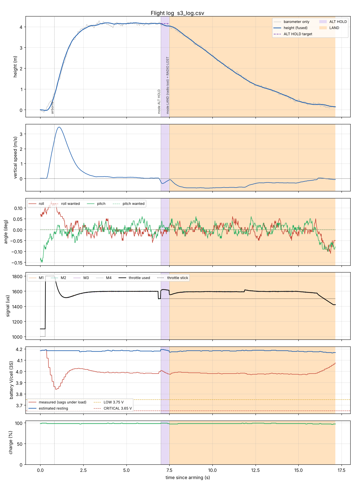

# 6. Altitude hold and automatic landing

## 6.1 Flying ALT HOLD

1. Take off in **MANUAL** and climb to **1.5–2 m**. Hover steadily for 3 seconds: the
   firmware learns the hover throttle.
2. Move SwC to the **middle**. One short beep, LED purple. (3 fast beeps = refused: below
   0.5 m, not airborne, or no barometer.)
3. Put the throttle stick in the **middle** (±100 µs dead band). The drone holds its height.
4. Throttle stick up = climb (max 0.8 m/s), down = descend (max 0.6 m/s). Let it go back to
   the middle to hold the new height. Roll, pitch and yaw work as in MANUAL.
5. Back to **MANUAL**: first put the throttle stick where the drone hovers in MANUAL
   (often a bit above the middle), then flip SwC.

Holding the throttle stick **fully down** in ALT HOLD lands the drone: it descends at
0.6 m/s, detects the ground and stops the motors.

> The FS-i6X throttle stick has no centre click. Many pilots put a small mark on the gimbal
> at the middle position.

## 6.2 LAND

Flip SwC to **LAND** (LED orange, beep-beep). The drone:

1. descends at **0.6 m/s** while higher than 1.5 m, then at **0.3 m/s**;
2. still obeys the right stick (move away from obstacles) and yaw;
3. detects the touchdown and **stops the motors** (2 short beeps).

To cancel, flip SwC to ALT HOLD or MANUAL (not possible during a battery landing).
LAND selected while the drone sits on the ground (or is lower than 0.3 m) simply stops
the motors.

## 6.3 Automatic landings

| Trigger | What happens |
|---------|--------------|
| radio frames stop for 0.25 s (receiver off, wire loose, out of range without receiver failsafe) | LAND, sticks treated as centred, lost-drone beeper after landing. When the radio comes back, move SwC to take over again. |
| receiver failsafe values arrive (CH6 = LAND, see 6.5) | LAND, exactly as if you flipped SwC. When the link comes back, the drone follows your real SwC position again. |
| battery CRITICAL for 5 s | LAND; SwC is ignored until landed; you can still steer. |
| barometer stops answering in ALT HOLD | LAND without barometer (6.6). |

Simulated radio loss at 4 m in ALT HOLD (scenario 3): the drone lands by itself in about
10 s and touches down at 0.11 m/s:

## 6.4 How the drone knows it has landed

A drone cannot "see" the ground. The firmware uses the idea from INAV's landing detector:
**the controller keeps asking for less throttle, but the drone does not move any more.**

During LAND (or ALT HOLD with the stick fully down) the firmware averages the throttle used
for the descent. The drone is declared *landed* when, for **1 second**, all of these hold:

- more than 2 s since the descent started;
- vertical speed between −0.25 and +0.25 m/s (it was −0.3 m/s while descending);
- the throttle is **40 µs below** the average descent throttle (the speed controller pushes
  down but nothing happens);
- roll, pitch and yaw rates below 20 °/s (not tumbling).

As soon as a touchdown is *likely* (still, and 20 µs under the average) the firmware lowers
the throttle faster and lets the PID I-terms decay, so the drone does not skate or tip
over. In the simulator the motors stop about 1.1 s after touchdown.

Safety nets if the detector never triggers:

| Net | Motors stop when |
|-----|------------------|
| throttle at the minimum | the controller sits at its lowest throttle (1130 µs) for 3 s with almost no vertical speed |
| time near the ground | the drone has spent `LAND_TIMEOUT_S` (30 s) in total below 1.5 m |
| no barometer | `LAND_NOBARO_TIME_S` (20 s) after the landing started |

## 6.5 Receiver failsafe: set it up for version 3

When the FS-iA10B loses the transmitter it can keep sending i-BUS frames with values you
choose ("failsafe values"). Version 3 needs **different values than the version 2 guide**:

| Channel | Old (v2) | **New (v3)** | Why |
|---------|----------|--------------|-----|
| CH1, CH2, CH4 | off | **On, sticks centred** | the drone levels and does not keep flying in the last direction |
| CH3 throttle | On, stick down | **On, stick down** | unchanged |
| CH5 SwA | On, SAFE (motors stop) | **Off** (keeps the last value = ARM) | so the drone can land instead of falling |
| CH6 SwC | – | **On, SwC on LAND** | the flight controller lands |

On the FS-i6X: **Menu → Functions setup → Failsafe**. For each channel: select it, put the
stick or switch in the position above, select *On* (or *Off* for CH5), then **hold CANCEL**
to save. CH6 must already be assigned to SwC (**Functions setup → Aux. channels →
Channel 6 = SwC**).

**Test (props off, sketch 2):** SwA on ARM, SwC on MANUAL, transmitter on. Switch the
transmitter **off**. Within about 1 s sketch 2 must show THR ≈ 1000, CH1/2/4 ≈ 1500,
CH5 still **ARM**, CH6 **LAND** (or `SIGNAL LOST`). Then the same test with the flight
controller, props off and LiPo in: arm, raise the throttle a little (motors turning slowly,
below about 1300 µs), switch the transmitter off: the motors must stop within about a
second ("LAND switch on the ground").

> If you keep the old v2 setting (CH5 = SAFE), the drone does not land on radio loss: it
> **stops the motors and falls**. That is acceptable very low over grass, not higher up.

## 6.6 Landing without a barometer

If the BMP280 is missing (or stops answering), the drone has no vertical speed
measurement. LAND then sets the throttle 40 µs (`LAND_NOBARO_DROP`) below the learned
hover throttle and stops the motors after 20 s. This is a **firm** landing: in the simulator
about 2 m/s from 3 m. Without a working barometer, fly low.

## 6.7 First tests, step by step

1. Bench (props off, LiPo in): status line `h` changes when you lift the drone by hand;
   `i` shows the BMP280. Put foam on the sensor.
2. Mode switch test (props off): arm, raise the throttle a little, flip SwC to ALT HOLD:
   3 fast beeps (refused: on the ground). Flip to LAND: motors stop.
3. First ALT HOLD flight: calm day, open grass field, 1.5 m. Be ready to flip SwC back to
   MANUAL and SwA to SAFE. Hold ALT HOLD 10 s, land in MANUAL.
4. Download the log and look at `alt`, `alt_target`, `vz` and `thr_out` (chapter 7). Tune
   (chapter 4.4) if needed.
5. First LAND from 2 m. Then from 5 m.
6. Failsafe in the air: at 3 m in ALT HOLD over grass, switch the transmitter off. The drone
   must land and stop. Switch the transmitter on again only after it has landed.
