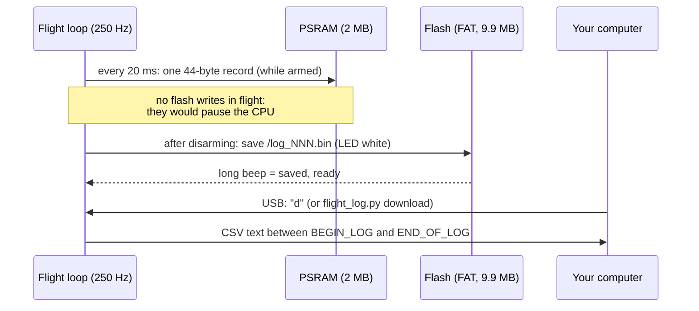
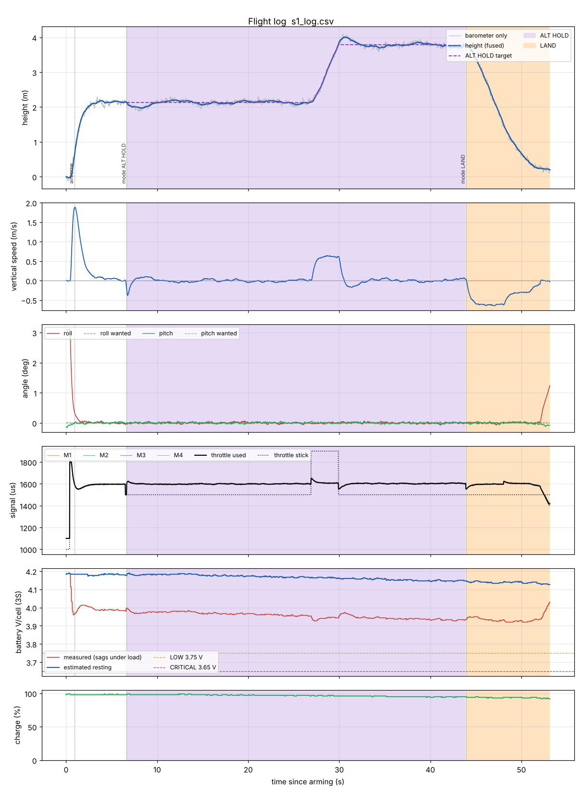

# 7. Flight logging

The drone records what it does 50 times per second while armed, like a small "black box".
After landing you download the log and plot it. Logs turn "it wobbles a bit" into numbers
you can compare between two PID settings, and they are great material for the
competition report.

## 7.1 How it works



- **Capacity:** 2 MB of PSRAM = about **16 minutes** at 50 Hz, more than one 3300 mAh
  battery. Without PSRAM (Tools → PSRAM disabled) only ~22 s fit in normal RAM.
- **Saving:** after disarming, the record is written to the flash file system as
  `/log_001.bin`, `/log_002.bin`, … It takes about 1 s per minute of flight. **Wait for the
  long beep before you unplug the battery.**
- **Space:** the 20 newest logs are kept (`LOG_MAX_FILES`); the oldest is deleted first.
- **Partition:** needs *Tools → Partition Scheme → 16M Flash (3MB APP/9.9MB FATFS)*.
  Without it, the last flight stays in RAM until power-off and `d` prints it from there.

## 7.2 What is recorded

| Column | Unit | Meaning |
|--------|------|---------|
| `t_s` | s | time since arming |
| `mode` | – | 0 MANUAL, 1 ALT HOLD, 2 LAND |
| `armed`, `airborne`, `radio_ok`, `batt_low`, `batt_crit`, `baro_ok`, `land_radio`, `land_batt` | 0/1 | state flags |
| `roll`, `pitch` | ° | estimated angles |
| `roll_sp`, `pitch_sp` | ° | wanted angles (from the sticks) |
| `yaw_rate` | °/s | filtered yaw rate |
| `alt`, `alt_target`, `baro_alt` | m | fused height, ALT HOLD target, barometer alone |
| `vz` | m/s | estimated vertical speed |
| `thr_in`, `thr_out` | µs | throttle stick, throttle used (after the height controller) |
| `m1` … `m4` | µs | motor commands |
| `vbat`, `vrest` | V | measured voltage, estimated resting voltage |
| `batt_pct` | % | charge estimate |
| `current` | A | current sensor (0 without one) |

## 7.3 Downloading and plotting

Install Python 3 and the tool's packages once:

```bash
cd tools
pip install -r requirements.txt
```

After a flight: wait for the long beep, unplug the LiPo, connect USB, **close the Arduino
Serial Monitor** (only one program can use the port), then:

```bash
python flight_log.py ports                        # which port is the drone?
python flight_log.py list --port COM10            # logs on the drone
python flight_log.py download --port COM10        # newest -> flight_20261015_183012.csv
python flight_log.py download --port COM10 --log 3 --out pid_test_3.csv
python flight_log.py summary pid_test_3.csv
python flight_log.py plot pid_test_3.csv          # window with the graphs
python flight_log.py plot pid_test_3.csv --save pid_test_3.png
```

(Linux / macOS ports look like `/dev/ttyUSB0` or `/dev/cu.usbserial-…`.) The tool keeps
DTR/RTS low so opening the port does not reset the ESP32; if the board still restarts, the
tool simply waits and asks again (up to 60 s).

Without Python you can also type `d` in the Serial Monitor, copy everything between
`BEGIN_LOG` and `END_OF_LOG` into a `.csv` file and open it in a spreadsheet.

`summary` prints, for example:

```
Armed ........... 53.1 s (2651 lines), in the air about 52.1 s
Highest ......... 4.01 m (fused height above take-off)
Time in MANUAL       6.6 s
Time in ALT HOLD    37.2 s
Time in LAND         9.2 s
Battery ......... 12.55 V -> 12.09 V measured, lowest 11.76 V under load
Charge .......... 98 % -> 92 % (estimated resting 12.38 V)
Motors at 100 % . 0.0 % of the time (if high: the drone lacks power or the PIDs fight)
Max tilt ........ 3.1 deg
Events:
     0.90 s  airborne
     6.66 s  mode ALT HOLD
    43.91 s  mode LAND
```

## 7.4 Reading the plot



| Panel | Look for |
|-------|----------|
| height | blue (fused) smooth and close to grey (barometer); in ALT HOLD (purple background) close to the dashed target |
| vertical speed | calm around 0 in ALT HOLD; −0.6 then −0.3 m/s in LAND (orange) |
| angles | solid line follows the dashed "wanted" line; big fast wiggles = P or D too high, slow waves = too low |
| motors | the four motor lines close to each other; one always higher = that corner is heavy or its motor/prop is weak; lines touching 2000 = not enough power |
| battery | red (measured) drops under load, blue (estimated resting) stays smooth; dashed lines = LOW and CRITICAL |
| charge | slowly falling line |

Events (mode changes, airborne, radio lost, battery LOW / CRITICAL, barometer lost) are drawn
as dotted vertical lines through all panels, with their names in the height panel.

Compare two flights with different PID values by plotting both and looking at the same
manoeuvre. Write the settings in the file name (`P1.3_D18.csv`).
