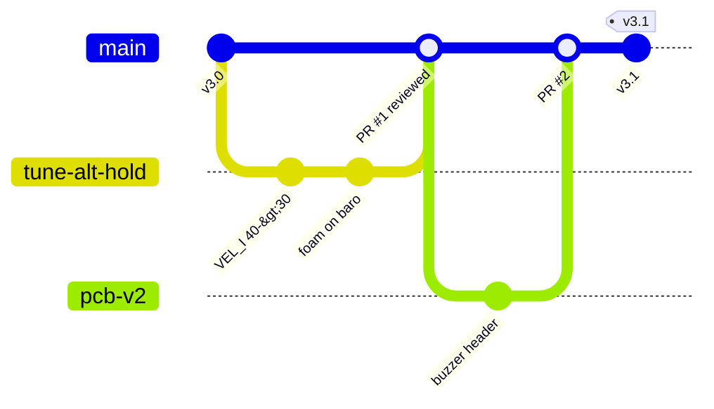

# 10. Working on GitHub with your friend

GitHub keeps every version of the project, lets your friend read and comment on the code,
and runs the simulator automatically after every change.

## 10.1 One-time setup

1. Create a GitHub account (you and your friend) at github.com.
2. Install **Git** from git-scm.com (on Windows this also installs *Git Bash* and a login
   helper), or install **GitHub Desktop** if you prefer buttons.
3. Tell Git who you are (once per computer):

   ```bash
   git config --global user.name  "Your Name"
   git config --global user.email "the email of your GitHub account"
   ```

## 10.2 Put the project online (first push)

On github.com: **+ → New repository** → name `esp32-drone-fc` → choose **Private** for now
→ do **not** add a README, .gitignore or license (the project already has them) →
**Create repository**.

Then in a terminal (Git Bash on Windows) inside the unzipped project folder:

```bash
cd esp32-drone-fc
git init
git add .
git commit -m "Flight controller v3: altitude hold, auto-landing, battery, logging, docs"
git branch -M main
git remote add origin https://github.com/YOUR-USERNAME/esp32-drone-fc.git
git push -u origin main
```

The first push opens a browser window to log in to GitHub. Refresh the repository page:
you see the README with the diagram, and the folders.

**With GitHub Desktop instead:** *File → Add local repository* → choose the folder → it
offers to *create a repository* there → *Create* → *Publish repository* (untick "Keep this
code private" only if you want it public).

## 10.3 Invite your friend

Repository → **Settings → Collaborators → Add people** → his GitHub username. He accepts
the e-mail invitation, then:

```bash
git clone https://github.com/YOUR-USERNAME/esp32-drone-fc.git
```

## 10.4 Daily workflow: branch → pull request → review → merge

Never work directly on `main`. Each change gets its own branch:

```bash
git switch main
git pull                                  # get your friend's latest work
git switch -c tune-alt-hold               # new branch
# ... edit config.h, test, fly ...
bash tools/sim/run_tests.sh               # must end with ALL SCENARIOS PASSED
git add -A
git commit -m "ALT HOLD: VEL_I 40 -> 30, less up-down breathing (log 7)"
git push -u origin tune-alt-hold
```

GitHub then shows **Compare & pull request**. Write what you changed and why, attach a
log plot, and ask your friend as reviewer. He opens **Files changed**, comments on lines,
and clicks **Approve** (or *Request changes*). The **Actions** tab (and the green tick on
the pull request) shows whether the simulator and the build passed. Then **Merge**.



Good habits:

- One topic per branch and per pull request; small commits with clear messages.
- Put flight results in the commit or PR message ("log 7: ±0.2 m in ALT HOLD").
- Use **Issues** for bugs and ideas ("BMP280 jumps near the ground"), and close them from a
  commit message: `Fixes #4`.
- Mark versions that flew well: `git tag v3.1 && git push --tags`, then *Releases → Draft a
  new release* and attach the PDF guide.

## 10.5 What your friend should review

He designed the PCB, so the most valuable review is where hardware and code meet:

- [ ] `firmware/4_flight_controller/config.h` section 3: every pin matches the schematic.
- [ ] [chapter 1](01-hardware.md): connector table, power rules, known PCB issues; ideas for PCB v2.
- [ ] buzzer on H3 pin 3 (GPIO 17): wiring and the "high level trigger" note.
- [ ] battery divider math and `VBAT_DIVIDER` (R3, R4 values on the real board).
- [ ] safety logic: [chapter 2.6](02-firmware-overview.md#26-what-stops-the-motors-or-lands-the-drone) and `updateFlightState()` in the `.ino`.
- [ ] the simulator results (Actions tab) and a real flight log.

## 10.6 What is in `.gitignore`

Build folders, Python caches, simulator outputs (`tools/sim/out/`) and downloaded flight
logs (`*.csv`, except the examples in `docs/`) are not committed. If you want to keep a
special log, put it in `docs/logs/` and mention it in the pull request.
