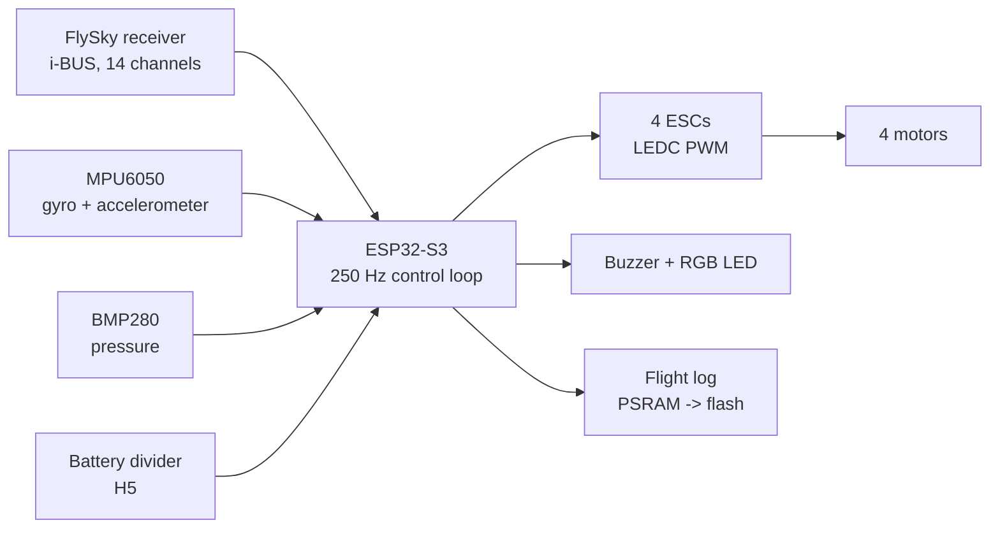

# Documentation

Read the chapters in order the first time. Each one explains **what the code does**,
**why**, and **how to use it**.

| # | Chapter | What you will find |
|---|---------|--------------------|
| 1 | [Hardware](01-hardware.md) | parts, the PCB connectors and pins, power rules, buzzer and LED wiring, known PCB issues |
| 2 | [Firmware overview](02-firmware-overview.md) | files, main loop timing, flight modes, arming, failsafes, every setting in `config.h`, serial commands |
| 3 | [Sensor fusion](03-sensor-fusion.md) | how the drone knows its angles (gyro + accelerometer) and its height (barometer + accelerometer) |
| 4 | [Control](04-control.md) | self-levelling, the rate PIDs, the motor mixer, the height controller, PID tuning |
| 5 | [Battery](05-battery.md) | voltage measurement, percentage without a current sensor, LOW / CRITICAL behaviour |
| 6 | [Altitude hold and auto-landing](06-altitude-hold-and-landing.md) | how to fly ALT HOLD and LAND, the landing detector, radio failsafe setup |
| 7 | [Flight logging](07-flight-logging.md) | what is recorded, how to download and plot it, how to read the graphs |
| 8 | [Testing procedure](08-testing-procedure.md) | bench tests and first flights for every new feature, with checklists |
| 9 | [Competition](09-competition.md) | how this project fits the AST Aerial Technology Cup (Topic 4), demo and report plan, legal note |
| 10 | [GitHub workflow](10-github-workflow.md) | how to put the project on GitHub, invite your friend, branches, pull requests, reviews |
| – | [Resources](resources.md) | books, papers, courses, documentation and open-source projects by real people |

The full step-by-step build guide (motors, ESCs, receiver binding, PID tuning) is the PDF
[`Drone_Build_Guide.pdf`](Drone_Build_Guide.pdf). These pages go deeper into the new
version 3 features and explain the code.

## The 30-second version

Every 4 ms the ESP32-S3 reads the radio and the sensors, estimates the drone's angles and
height, decides what the drone should do (MANUAL, ALT HOLD or LAND, or a failsafe), runs
the PID controllers and sends a new speed to each motor.

> **Safety first.** Props off for every bench test. First flights low, over grass, away
> from people, with the kill switch (SwA) under your finger. See [chapter 8](08-testing-procedure.md).
